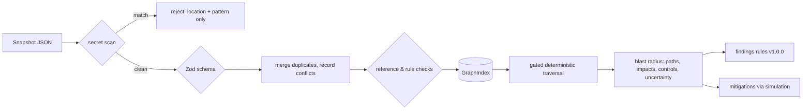

# Architecture

AgentRadius is a local process with a loopback API and a browser UI. Everything runs as the logged-in user. Nothing is uploaded.

## Modules

```mermaid
flowchart TB
  ui["ui/ (React)"] -->|types only| contracts["api/contracts.ts"]
  ui --> core["domain/core.ts (values, no Zod)"]
  api["api/ (node:http)"] --> application
  application["application/ (use cases)"] --> analysis
  application --> graph
  application --> fixtures
  analysis["analysis/ (blast radius, findings, simulation)"] --> graph
  graph["graph/ (ingest, merge, traversal)"] --> domain
  graph --> redaction
  analysis --> domain
  fixtures["fixtures/ (labeled demo data)"] --> domain
  domain["domain/ (vocabulary, schema, semantics)"]
  redaction["redaction/ (secret patterns)"]
```

The allowed dependency directions are enforced by `tests/architecture.test.ts`. Any import that crosses a module boundary must be listed there.

| Module        | Responsibility                                                                                                             | Must not                                                                                             |
| ------------- | -------------------------------------------------------------------------------------------------------------------------- | ---------------------------------------------------------------------------------------------------- |
| `domain`      | Vocabulary, Zod schemas, edge semantics, attribute accessors, finding schema                                               | Import anything else                                                                                 |
| `redaction`   | Secret pattern detection, reporting locations only                                                                         | Return matched values                                                                                |
| `graph`       | Ingestion: secret scan, schema check, merge, reference checks. Indexing, path summaries, deterministic traversal.          | Know about findings or UI                                                                            |
| `analysis`    | Blast radius, controls, findings rules, simulation, mitigations, overview, permission inventory                            | Do I/O                                                                                               |
| `fixtures`    | Explicitly labeled synthetic snapshots                                                                                     | Contain real-looking secrets                                                                         |
| `application` | Use cases: load a snapshot, build views, run analyses. Chooses `asOf` (the snapshot time for fixtures, now for live data). | Know about HTTP                                                                                      |
| `api`         | Hardened loopback HTTP and static serving                                                                                  | Contain business logic                                                                               |
| `ui`          | Dashboard                                                                                                                  | Import server code. Only types from `api/contracts.ts` and values from `domain/core.ts` are allowed. |

Planned modules, not yet present: `connectors/` (read-only discovery), `policy/`, `runtime/` (stdio proxy), `audit/`, `storage/`. See the [roadmap](./implementation-roadmap.md).

## Request flow

1. On startup, `src/api/main.ts` creates the demo workspace. That calls `ingestSnapshot` on the fixture, which runs the secret scan, Zod parse, merge, and reference validation.
2. The browser loads the built UI from `dist/ui` (or the Vite dev server proxies `/api`).
3. `GET /api/v1/workspace` returns nodes, edges, connector runs, overview, findings, permission inventory, the settings used, and the IDs of stale entities.
4. `POST /api/v1/blast-radius {startId, settings?}` returns the paths, impacts, controls, uncertainty, and mitigations.
5. `POST /api/v1/simulations {startId, changes[], settings?}` returns a before/after diff computed on an in-memory copy.

Every response is computed. Nothing is persisted.

## Analysis pipeline



## Determinism

Fixed input, settings, and `asOf` always produce the same output:

- Candidate edges and results are sorted by ID.
- Finding IDs are derived from the rule and the affected entities.
- `detectedAt` equals `asOf`.
- The UI layout is a pure function.

Tests check determinism with reversed input order.

## Running

| Command                      | What it does                                                                      |
| ---------------------------- | --------------------------------------------------------------------------------- |
| `npm run dev`                | API on `127.0.0.1:4317` (restarts on change) plus the Vite UI on `127.0.0.1:5173` |
| `npm run build && npm start` | Serves the production UI and API from `127.0.0.1:4317`                            |
| `npm run check`              | Typecheck, lint, format check, all tests                                          |
| `npm run schemas`            | Regenerates `schemas/*.schema.json` from Zod                                      |
| `AGENTRADIUS_PORT=…`         | Overrides the API port (1024–65535)                                               |
