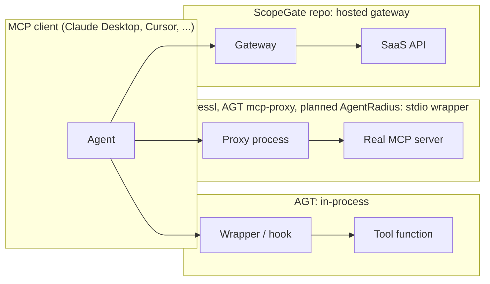

# Architecture comparison

How each reference is put together, and which choices AgentRadius makes differently and why. Evidence labels and pinned commits are in [`source-register.md`](./source-register.md).

## Deployment shape

|                         | Runs where                                        | Trust boundary                                                                                   | Data leaves the device?                                            |
| ----------------------- | ------------------------------------------------- | ------------------------------------------------------------------------------------------------ | ------------------------------------------------------------------ |
| ScopeGate (repo)        | Hosted Next.js app with Postgres                  | Operator, database, and host are fully trusted                                                   | Yes. Tokens and audit live on the server.                          |
| ScopeGate (docs)        | Local stdio gateway, with an optional cloud plane | The user's account. Documented: "a malicious process running as your user can call the gateway". | Optional, via the cloud plane                                      |
| AGT                     | Library inside the agent process                  | The host process. Bypassable if the host keeps unwrapped objects.                                | Depends on the integrator                                          |
| ressl/mcp-firewall      | Local stdio wrapper                               | The user's account. Unauthenticated dashboard endpoints.                                         | No                                                                 |
| mukuna-web/mcp-firewall | Library                                           | The caller                                                                                       | No                                                                 |
| ScopeMantle             | Hosted SaaS, region-pinned                        | The vendor                                                                                       | Yes, by design                                                     |
| AuthScope               | Hosted workers (Celery, Postgres, S3)             | The operator                                                                                     | Yes. Evidence goes to S3.                                          |
| **AgentRadius**         | **Local process: loopback API plus browser UI**   | **The user's account. Discovery is read-only. Enforcement is opt-in per server.**                | **No. Nothing is uploaded by default, and there is no telemetry.** |

## Where policy is enforced

- **In-process** (AGT) is the cheapest option and has the richest context, but it is cooperative. AgentRadius labels this kind of control `advisory`.
- **Stdio wrapper** (ressl, the AGT TS proxy) is a real mediation point for one server, **as long as the client config launches the wrapper instead of the server**. Anything that launches the server directly bypasses it. AgentRadius will verify the launch path before it labels a server `enforced_verified` ([ADR 0007](../adr/0007-enforcement-strategy.md)).
- **Hosted gateway** (ScopeGate) is a real mediation point for SaaS calls, but it moves credentials and trust off the device.

## Policy representation

|                           | Unit of permission                                            | Argument constraints                             | Default                          | Conflict resolution                                                              |
| ------------------------- | ------------------------------------------------------------- | ------------------------------------------------ | -------------------------------- | -------------------------------------------------------------------------------- |
| ScopeGate repo            | `provider:verb` string per endpoint                           | none                                             | deny (tool not registered)       | n/a                                                                              |
| AGT ACS                   | Rego/Cedar decision with verdict allow/deny/transform         | Arbitrary (policy language)                      | Spec: errors produce deny        | `extends` is additive; conflicts fail closed                                     |
| AGT legacy YAML           | Rules with 4 strategies                                       | Expressions                                      | **Code: deny. Docs: allow.**     | Default `priority_first_match`                                                   |
| ressl                     | YAML glob rules plus per-agent lists                          | Glob on exact argument keys                      | `prompt` (deny without a broker) | First match; agent deny wins                                                     |
| mukuna-web                | TOML exact tool name                                          | `path_roots`, `url_domains` on literal arg names | deny                             | First match                                                                      |
| **AgentRadius (planned)** | Rule over (server identity, tool, schema-validated arguments) | Typed against the tool's declared input schema   | Enforce: deny. Monitor: record.  | Deny overrides. Most specific wins among allows. Ties are a configuration error. |

## Data and evidence model

The references differ most here, and here AgentRadius differs from all of them.

|                    | Graph?                                                             | Provenance per fact                                                                        | Uncertainty model                                                                                              | Separates facts from conclusions                                                                                   |
| ------------------ | ------------------------------------------------------------------ | ------------------------------------------------------------------------------------------ | -------------------------------------------------------------------------------------------------------------- | ------------------------------------------------------------------------------------------------------------------ |
| ScopeGate          | No                                                                 | Audit rows only                                                                            | none                                                                                                           | n/a                                                                                                                |
| AGT                | Delegation chains, agent-dependency counting                       | Audit chain                                                                                | Trust score 0–1000 (behavioral, not evidential)                                                                | Partial                                                                                                            |
| ressl / mukuna-web | No                                                                 | Audit chain                                                                                | none                                                                                                           | n/a                                                                                                                |
| AuthScope          | No                                                                 | Per-signal evidence                                                                        | Confidence from corroboration                                                                                  | Findings with signals                                                                                              |
| **AgentRadius**    | **Yes: typed, directed, with propagation semantics per edge type** | **Required on every node and edge (connector, evidence reference, observed time, method)** | **Assertion (observed, declared, inferred, hypothetical, unknown) × confidence × freshness × condition state** | **Yes. Findings are never stored as graph facts ([ADR 0004](../adr/0004-assertions-provenance-and-findings.md)).** |

## Audit integrity

All three proxies chain their log entries with SHA-256. None of them can stop a same-user attacker from deleting the log. AGT and ScopeGate (docs) say so explicitly, and mukuna-web's README admits it.

AgentRadius plans:

- SHA-256 chained JSONL.
- Arguments hashed, never stored raw.
- In enforce mode, an audit-sink failure means `DENY`.
- An optional Ed25519 signing key held in the login Keychain (P2).

The documentation will state the same-user limitation plainly rather than imply tamper-proofing.

## Choices AgentRadius makes differently

1. **Explain before enforcing.** The first deliverable is visibility: the graph, blast radius, and findings. The references build enforcement first and never show what is reachable.
2. **Unknown is not denied.** No reference models missing evidence. AgentRadius keeps `unknown` edges out of reachability by default and surfaces them as their own findings and uncertainty counts.
3. **Controls are graded, not assumed.** A policy that exists somewhere (branch protection, an in-process hook, a monitor-only rule) does not shrink blast radius unless it is a verified, enforced deny.
4. **Fixture and live data can never be confused.** The schema requires `fixtureNotice` on fixture snapshots, and the UI banner is not dismissible.
5. **One language and one contract.** The Zod schema is the single source for validation, TypeScript types, and the generated JSON Schema ([ADR 0003](../adr/0003-canonical-schema-v2.md)).
